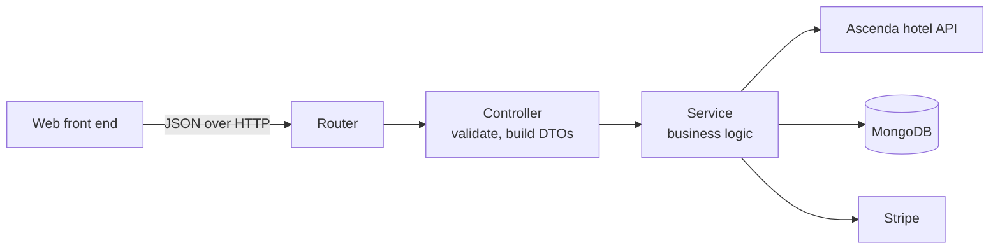

# ESC Ascenda Server (50.003 Hotel Booking Backend)

REST API behind a hotel booking web app, built by a team of seven for the SUTD 50.003 Elements of Software Construction project (Term 5, 2025). The API searches hotels through the Ascenda hotel API, returns hotel details and room prices, signs users up and in, and takes card payments through Stripe. This repository contains only the backend. The web front end is a separate repository. The original team repository is [NadineeSCH/ESC_Ascenda_Server](https://github.com/NadineeSCH/ESC_Ascenda_Server).

## What the backend does

- **Hotel search.** Takes a destination, dates and guests. Returns a cleaned list of hotels with prices. The caller can filter by price, star rating and guest score, and sort by any of the three.
- **Hotel details and rooms.** Returns the details of one hotel (location, amenities, images) together with its available rooms and prices.
- **Accounts.** Sign-up with an email one-time password (OTP). Login returns a JWT.
- **Payments.** Creates a Stripe PaymentIntent. Card details never reach this server.
- **Profile.** View, update and delete an account. Purchase history comes from Stripe.
- **Search cache.** A MongoDB cache of Ascenda search responses. It lives on the `hotelresultscaching` branch (see [Branches](#branches)).

## Architecture

A layered Express API. Each request passes through a router, a controller and a service.



| Layer | Folder | Responsibility |
|---|---|---|
| Router | `routes/` | Maps a URL and HTTP method to a controller function. |
| Controller | `controller/` | Checks the request, builds DTOs, chooses the HTTP status. |
| Service | `service/` | Calls Ascenda, Stripe and MongoDB. Cleans, filters and sorts data. |
| DTO | `DTO/` | Plain classes for request parameters, filters, sort options and results. |
| Model | `models/` | Mongoose schemas (`User`, `HotelResultsCache`). |
| Middleware | `middleware/` | JWT check for protected routes. |
| Utilities | `utils/` | Ascenda URL builder, polling client and a null-safe helper. |

**Stack:** Node.js, Express 5, MongoDB with Mongoose, Stripe, JSON Web Tokens, bcryptjs, Nodemailer, express-rate-limit, Jest with Supertest.

For the full walkthrough see:

- **[docs/architecture.md](docs/architecture.md)** covers the layers, data model, authentication, payments and the endpoint list.
- **[docs/hotel-search.md](docs/hotel-search.md)** covers the hotel search pipeline and the cache.
- **[docs/testing.md](docs/testing.md)** covers the test strategy and the test suites.

## Branches

| Branch | Contents |
|---|---|
| `main` | The final test suite. The search service has no cache. |
| `hotelresultscaching` | The final backend according to the project report. It adds the MongoDB search cache. |

## Repository layout

```
server.js            App setup: rate limits, CORS, MongoDB connection, routes
routes/              One router per feature
controller/          Request validation and HTTP responses
service/             Business logic and calls to external services
DTO/                 Parameter and result classes
models/              Mongoose schemas
middleware/          JWT authentication
utils/               Ascenda client and helpers
test/
  unit_tests/        One suite per source file, with mocks
  integration_tests/ Suites that run several layers together
  mocks/             Sample Ascenda responses and user data
  setup/             Jest setup and in-memory MongoDB helper
docs/                Architecture, hotel search and testing documentation
```

## Running locally

1. Install Node.js 18 or later and have a MongoDB instance ready.
2. Run `npm install`.
3. Create a `.env` file in the project root with these values:

   | Variable | Purpose |
   |---|---|
   | `MONGODB_URI` | MongoDB connection string. |
   | `JWT_SECRET` | Secret that signs login tokens. |
   | `STRIPE_SECRET_KEY` | Stripe secret key (a test key works). |
   | `EMAIL_SENDER`, `EMAIL_PASSWORD` | SMTP login for the OTP email. |
   | `PORT` | Optional. Defaults to `5001`. |

4. Run `npm start`. The server listens on `http://localhost:5001`.
5. Run `npm test` to run the Jest suites.

The server allows cross-origin requests from `http://localhost:3000` only.

## My contribution

- **Architecture:** proposed the router, controller and service layering that the backend modules follow.
- **Hotel search:** built the hotel results module: the router, the controller (request validation and DTOs), and the service (Ascenda integration, data cleaning, filtering and sorting), plus the Ascenda API client utility.
- **Caching:** helped build the MongoDB search cache prototype and worked on its cache key design.
- **Testing:** wrote the unit and integration tests for the hotel results module and the Ascenda client, about 160 test cases.

---

*Note: The README and the `docs/` folder were added much later, as part of a cleanup effort. The code itself was not changed.*
