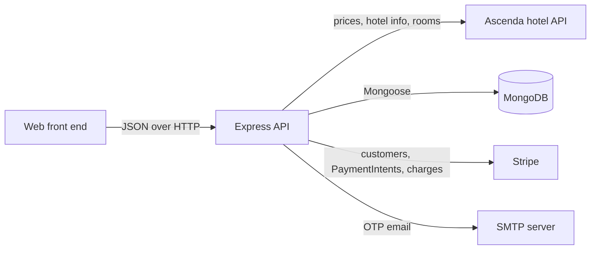
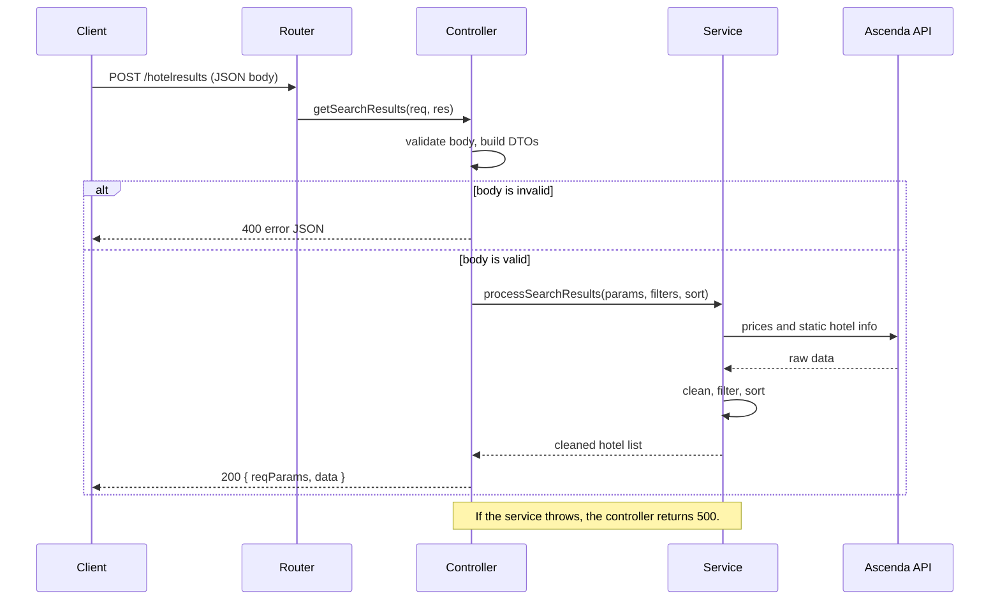
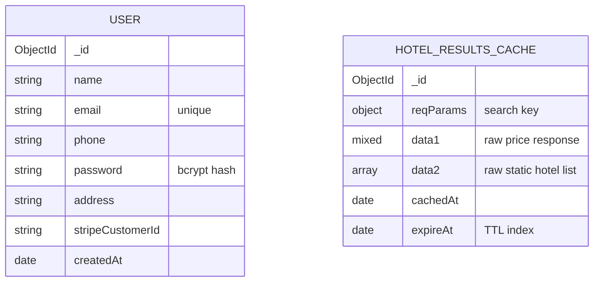
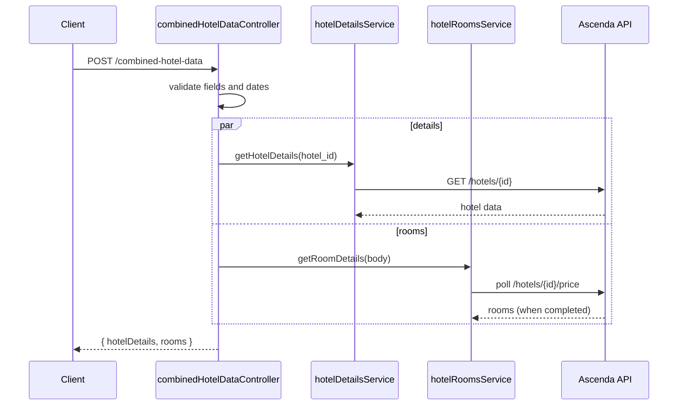
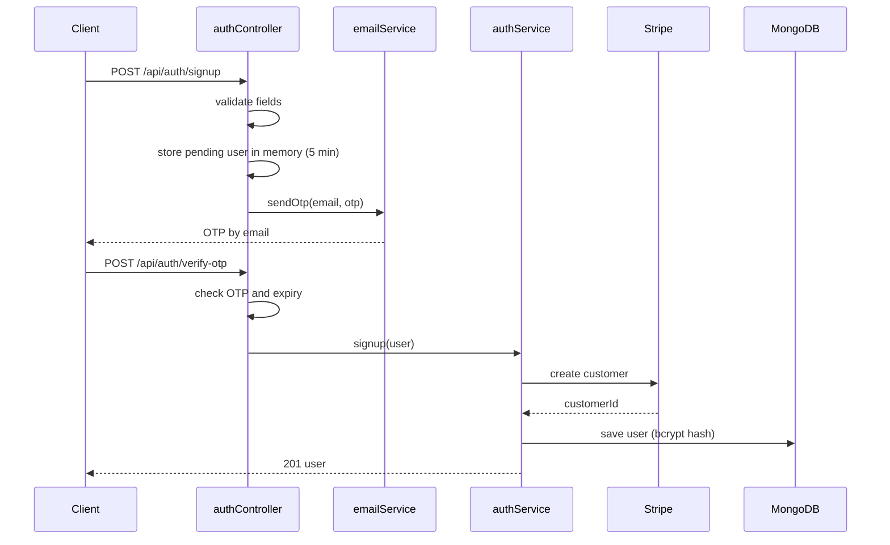
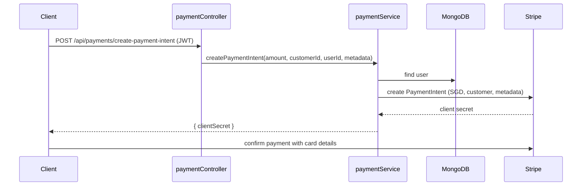

# Backend Architecture

This document explains how the backend is built. It helps you understand the design without reading all of the code. It stays at a high level. Two other documents go deeper on the hotel search module and its tests: [hotel-search.md](hotel-search.md) and [testing.md](testing.md).

Paths in this document are relative to the repository root.

- [1. Overview](#1-overview)
- [2. Layers and request lifecycle](#2-layers-and-request-lifecycle)
- [3. Project structure](#3-project-structure)
- [4. Data model](#4-data-model)
- [5. Hotel search](#5-hotel-search)
- [6. Hotel details and rooms](#6-hotel-details-and-rooms)
- [7. Authentication](#7-authentication)
- [8. Payments](#8-payments)
- [9. Profile](#9-profile)
- [10. Cross-cutting rules](#10-cross-cutting-rules)
- [11. Endpoint reference](#11-endpoint-reference)

## 1. Overview

The backend is one Express service. It does four things:

- It accepts JSON requests from the web front end.
- It gets hotel data from the Ascenda hotel API.
- It stores users (and, on one branch, a search cache) in MongoDB.
- It uses Stripe for customers and payments.

The backend does not store hotels, rooms or bookings. Ascenda holds the hotel data. Stripe holds the payment records.

## 2. Layers and request lifecycle

Each feature uses the same three layers. Each layer has one job.

| Layer | Job | Does not |
|---|---|---|
| Router | Maps a path and method to a controller function. | Contain logic. |
| Controller | Checks the request body. Builds DTOs. Chooses the HTTP status. | Call external services directly. |
| Service | Calls Ascenda, Stripe and MongoDB. Applies business rules. | Read `req` or `res`. |

Two more parts support the layers:

- **DTOs** (`DTO/DTO.js`) are small classes. They carry request parameters, filters, sort options and result rows between layers.
- **Models** (`models/`) are Mongoose schemas.

When you understand one feature, you understand the others. This diagram shows a hotel search:

## 3. Project structure

| Path | Purpose |
|---|---|
| `server.js` | Creates the app. Sets rate limits and CORS. Connects to MongoDB. Mounts all routers. |
| `routes/` | `authRoutes`, `paymentRoutes`, `profRoutes`, `hotelResultsRouter`, `hotelDetailsRouter`, `hotelRoomsRouter`, `combinedHotelDataRouter`. |
| `controller/` | One controller for each router. |
| `service/` | `authService`, `emailService`, `paymentService`, `profService`, `hotelResultsService`, `hotelDetailsService`, `hotelRoomsService`, `validate`. |
| `DTO/DTO.js` | `ReqParam31`, `ReqParam32`, `filterParams`, `sortParams`, `HotelResult`. |
| `models/` | `User`. On the caching branch also `HotelResultsCache`. |
| `middleware/authMiddleware.js` | Checks the JWT and loads the user. |
| `utils/` | `utils.js` has the polling client. `utils2.js` has the Ascenda URL builder and caller, and `safeAssign`. |
| `test/` | Jest suites. See [testing.md](testing.md). |

## 4. Data model

MongoDB holds one collection of users. The caching branch adds a second collection for cached search responses.

The two collections have no relationship. `HOTEL_RESULTS_CACHE` exists only on the `hotelresultscaching` branch. See [hotel-search.md](hotel-search.md#7-caching).

Each user has a `stripeCustomerId`. The backend creates the Stripe customer when the user verifies the OTP. The Stripe ID links the user to payments and purchase history.

## 5. Hotel search

`POST /hotelresults` returns a list of hotels for a destination. The request can include filters and a sort option.

This feature has its own document: [hotel-search.md](hotel-search.md). The document covers the validation rules, the data cleaning, the filter and sort pass, and the cache.

## 6. Hotel details and rooms

The front end shows one hotel on a detail page. The page needs the hotel information and the room prices. `POST /combined-hotel-data` returns both in one response.

| Service | What it does |
|---|---|
| `hotelDetailsService` | Fetches one hotel. Keeps name, address, rating, coordinates, description, amenities, categories, image details and check-in time. |
| `hotelRoomsService` | Builds the guest string (for example `2\|2` for two rooms with two guests each). Polls the Ascenda price endpoint until it reports `completed`. Keeps these fields for each room: description, free cancellation, breakfast information, additional information, long description, price and hero image. |

The controller needs seven string fields: `hotel_id`, `destination_id`, `checkin`, `checkout`, `currency`, `guestsEachRoom` and `rooms`. It applies the same date rules as hotel search. If either service fails, the controller returns `500`.

## 7. Authentication

Sign-up uses an email OTP. Login returns a JWT.

### Sign-up

The sign-up rules are:

| Field | Rule | Checked in |
|---|---|---|
| Name | 2 to 50 characters. Letters, spaces, hyphens and apostrophes only. | `validate.js` |
| Phone | 8 digits. The first digit is 6, 8 or 9 (Singapore format). | `validate.js` |
| Password | At least 8 characters. At least one uppercase letter, one lowercase letter and one digit. | `validate.js` |
| All fields | Name, email, phone, password and address must be present and must be strings. | `authController` |
| Email | Must not belong to an existing user. | `authService` (at the OTP step) |

The pending user stays in an in-memory `Map` until the user verifies the OTP. The service hashes the password with bcrypt (10 rounds) when it creates the account.

### Login and token check

1. The client sends `POST /api/auth/login` with an email and a password.
2. `authService.login` finds the user and compares the password with bcrypt.
3. The service signs a JWT with the payload `{ _id }`. The token expires in 1 hour.
4. For a protected route, the client sends `Authorization: Bearer <token>`.
5. `authMiddleware` verifies the token and loads the user from MongoDB. It attaches the user to `req.user`.

| Case | Status |
|---|---|
| No token | 401 |
| Token is valid but the user does not exist | 404 |
| Token is invalid or expired | 403 |

## 8. Payments

The backend creates a Stripe PaymentIntent. The backend never receives card details.

1. The service checks that `amount`, `customerId` and `userId` are present.
2. The service loads the user and copies the user's address into the PaymentIntent metadata.
3. The service creates the PaymentIntent in Singapore dollars.
4. The client confirms the payment with Stripe, using the client secret.

## 9. Profile

All profile routes need a JWT.

| Route | Behaviour |
|---|---|
| `GET /api/profile/get` | Returns the user without the password. |
| `PATCH /api/profile/patch` | Accepts `name`, `email`, `phone` and `address` only. Updates the matching Stripe customer fields, then MongoDB. |
| `DELETE /api/profile/delete` | Deletes the Stripe customer, then the MongoDB user. |
| `GET /api/profile/history` | Lists up to 100 Stripe charges for the customer. Each row has the amount, status, receipt URL, metadata and the last four card digits. |

Account deletion removes the personal data that the backend controls: the Stripe customer and the MongoDB user.

## 10. Cross-cutting rules

| Rule | Where |
|---|---|
| Login attempts: 5 per 15 minutes for each client. Successful logins do not count. | `server.js` on `/api/auth/login` |
| Payment requests: 10 per 15 minutes. | `server.js` on `/api/payments` |
| Profile requests: 20 per 15 minutes. | `server.js` on `/api/profile` |
| CORS allows `http://localhost:3000` only. | `server.js` |
| A malformed JSON body returns `400`. Any other unhandled error returns `500`. | Error middleware in `server.js` |
| Secrets come from environment variables. | `.env` (ignored by git) |

## 11. Endpoint reference

| Method and path | Auth | Purpose |
|---|---|---|
| `POST /api/auth/signup` | No | Start sign-up. Sends an OTP. |
| `POST /api/auth/verify-otp` | No | Finish sign-up. |
| `POST /api/auth/login` | No | Returns a JWT and the user. |
| `POST /api/payments/create-payment-intent` | JWT | Returns a Stripe client secret. |
| `GET /api/profile/get` | JWT | Read the profile. |
| `PATCH /api/profile/patch` | JWT | Update the profile. |
| `DELETE /api/profile/delete` | JWT | Delete the account. |
| `GET /api/profile/history` | JWT | Read the purchase history. |
| `POST /hotelresults` | No | Search hotels. See [hotel-search.md](hotel-search.md). |
| `POST /combined-hotel-data` | No | Hotel details and rooms in one response. |
| `POST /hoteldetails` | No | Hotel details only. |
| `POST /hotelrooms` | No | Rooms only. |
| `GET /test` | No | Health check. Returns `Server is working!`. |
