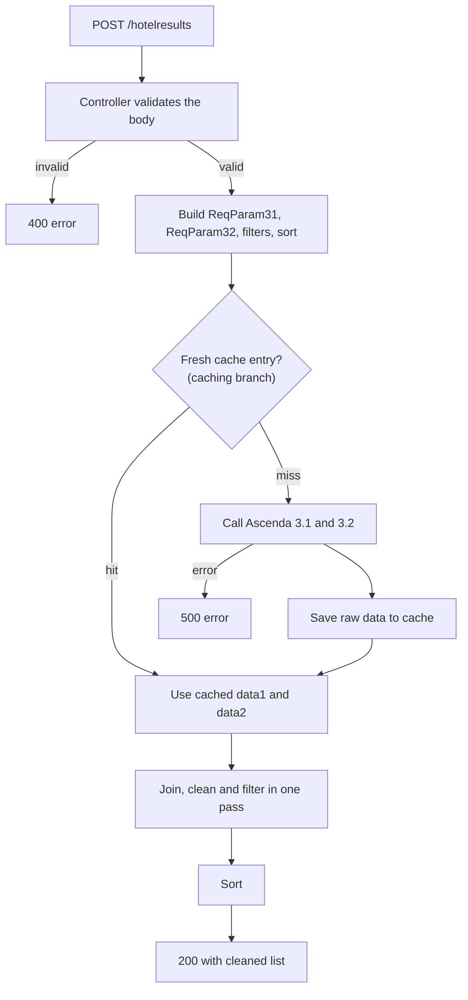
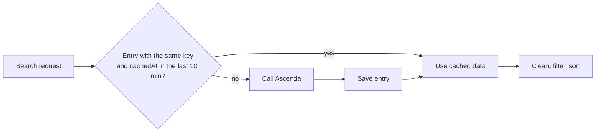

# Hotel Search and Caching

This document explains how `POST /hotelresults` works. It covers the request, the pipeline, the data cleaning and the cache.

**Scope:** this document covers only the hotel search module, which the README lists under "My contribution". The cache is a separate branch (`hotelresultscaching`). The other modules (authentication, payments, profile, hotel details and rooms) are described at a high level in [architecture.md](architecture.md).

- [1. Purpose](#1-purpose)
- [2. Request and response](#2-request-and-response)
- [3. Pipeline](#3-pipeline)
- [4. Validation](#4-validation)
- [5. Data cleaning](#5-data-cleaning)
- [6. Filtering and sorting](#6-filtering-and-sorting)
- [7. Caching](#7-caching)
- [8. Ascenda API client](#8-ascenda-api-client)
- [9. Design choices](#9-design-choices)

## 1. Purpose

The Ascenda hotel API splits hotel data across two calls:

| Call | Code name | Returns |
|---|---|---|
| Prices for a destination | `api_no = 1` (Ascenda 3.1) | Price and availability for each hotel. The call is asynchronous, so the client polls it. |
| Static hotel list for a destination | `api_no = 2` (Ascenda 3.2) | Name, location, description, rating, images and score for each hotel. |

The front end needs one list. The search service joins the two responses, removes bad rows, applies the user's filters and sorts the result.

Files:

| File | Role |
|---|---|
| `routes/hotelResultsRouter.js` | Routes `POST /` to the controller. |
| `controller/hotelResultsController.js` | Validates the request and builds the DTOs. |
| `service/hotelResultsService.js` | Gets the data (or the cache), cleans, filters and sorts. |
| `utils/utils2.js`, `utils/utils.js` | Ascenda URL builder, caller and polling client. |
| `DTO/DTO.js` | `ReqParam31`, `ReqParam32`, `filterParams`, `sortParams`, `HotelResult`. |
| `models/HotelResultsCache.js` | Cache schema (caching branch only). |

## 2. Request and response

### Request body

```json
{
  "destination_id": "RsBU",
  "checkin": "2026-01-10",
  "checkout": "2026-01-14",
  "lang": "en_US",
  "currency": "SGD",
  "rooms": 2,
  "guestsEachRoom": 2,
  "filter_exist": true,
  "filters": {
    "minPrice": 100, "maxPrice": 600,
    "minRating": 3, "maxRating": 5,
    "minScore": 0, "maxScore": 100
  },
  "sort_exist": true,
  "sort_var": "price",
  "reverse": false
}
```

| Field | Type | Notes |
|---|---|---|
| `destination_id` | string | Ascenda destination ID. |
| `checkin`, `checkout` | string | Dates. See [section 4](#4-validation). |
| `lang`, `currency` | string | For example `en_US` and `SGD`. |
| `rooms`, `guestsEachRoom` | number or string | Parsed as integers. |
| `filter_exist` | boolean | `true` turns on filtering. |
| `filters` | object | Needed when `filter_exist` is `true`. |
| `sort_exist` | boolean | `true` turns on sorting. |
| `sort_var` | string | `price`, `rating` or `score`. Needed when `sort_exist` is `true`. |
| `reverse` | boolean or number | `true` sorts from high to low. Needed when `sort_exist` is `true`. |

### Response body

```json
{
  "reqParams": { "...": "the request body, echoed back" },
  "data": [
    {
      "id": "cCrl",
      "price": 176.06,
      "name": "Hotel name",
      "latitude": 1.29,
      "longitude": 103.85,
      "description": "...",
      "address": "...",
      "rating": 4,
      "distance": 1200,
      "checkinTime": "14:00",
      "imageUrl": "https://.../1.jpg",
      "score": 85
    }
  ]
}
```

## 3. Pipeline



On `main`, the service skips the cache. It calls the two Ascenda endpoints one after the other. On `hotelresultscaching`, it calls them in parallel with `Promise.all` after a cache miss.

## 4. Validation

The controller rejects a bad request with status `400`. It returns an `error`, a `message` and a `details` object.

1. The body must not be empty.
2. These fields must be present and have the right type: `destination_id`, `checkin`, `checkout`, `lang`, `currency` (strings), `guestsEachRoom` and `rooms` (string or number), `sort_exist` and `filter_exist` (booleans).
3. `checkin` and `checkout` must be valid dates.
4. `checkin` must be at least 3 days after today.
5. `checkout` must be after `checkin`.
6. If `sort_exist` is `true`: `sort_var` must be `price`, `rating` or `score`, and `reverse` must be a boolean or a number.
7. If `filter_exist` is `true`: `filters` must be an object. Each of the six keys (`minPrice`, `maxPrice`, `minRating`, `maxRating`, `minScore`, `maxScore`) must be a number or `null`.

After validation, the controller builds the guest string. Ascenda expects one number for each room, separated by `|`. Two rooms with three guests each give `3|3`.

## 5. Data cleaning

The service builds a `HotelResult` for each hotel in the price response. These rules apply:

| Case | Result |
|---|---|
| The hotel has no price. | The hotel is dropped. |
| The hotel is in the static list but not in the price list. | The hotel is not in the result. |
| The hotel is in the price list but not in the static list. | The row keeps `id` and `price`. `rating` is `2.5` and `score` is `70`. Other fields are `null`. |
| `rating` is missing. | `2.5`. |
| `score` is missing (`trustyou.score.overall`). | `70`. |
| The hotel has images and an image prefix. | `imageUrl` is the prefix plus `1.jpg`. |
| The hotel has no images. | `imageUrl` is `null`. |
| A field is `undefined`, `""` or `null`. | `safeAssign` turns it into `null`. |

## 6. Filtering and sorting

The service filters during the cleaning pass. It does not make a second pass.

1. Convert the static hotel list to a `Map` keyed by hotel ID. This takes one pass over the list.
2. Go through the price list once. For each hotel, look up the static data in the `Map` and build the `HotelResult`.
3. Before adding the row to the output, check the filters. A row that fails any filter is not added.
4. After the pass, sort the output with the built-in `Array.prototype.sort`.

The filters are inclusive bounds on `price`, `rating` and `score`. A `null` bound turns that bound off. The sort uses `sort_var` as the key. With `reverse` set, the comparator swaps its arguments, so the sort runs once in either direction. An unknown `sort_var` leaves the list unsorted.

Cost: the join and filter take time proportional to the size of the two lists. The sort takes the usual `n log n` time on the filtered list.

## 7. Caching

The cache is a prototype. It lives on the `hotelresultscaching` branch.

### What the cache stores

The cache stores the two raw Ascenda responses. It stores them before cleaning, filtering and sorting.

| Field | Content |
|---|---|
| `reqParams` | The search key. See below. |
| `data1` | The raw price response. |
| `data2` | The raw static hotel list. |
| `cachedAt` | When the service saved the entry. |
| `expireAt` | `cachedAt` plus 10 minutes. |

### The cache key

The key is the set of parameters that change the Ascenda response:

`destination_id`, `checkin`, `checkout`, `lang`, `currency`, `guests` and `partner_id`.

The model also has a `hotel_id` field. Hotel search does not use it, so the service stores `null`.

The key does not include the filters or the sort option. This choice has a reason. Users often repeat the same search and change only the filters. These requests share one cache entry. A key with the filters in it would create many entries that nobody reuses.

The key does include the guest string. The Ascenda prices change with the number of rooms and guests. A key with only destination and dates would return wrong prices.

### How the cache behaves



- **Freshness.** The lookup accepts an entry only if `cachedAt` is within the last 10 minutes. A second rule backs this up: a TTL index on `expireAt` lets MongoDB delete old entries.
- **One entry for each key.** A unique compound index covers the key fields.
- **Lookup failure.** The service logs the error and treats the request as a miss.
- **Save failure.** The service logs a warning. The request still succeeds.

### Why cache here

The price call needs polling. Each search waits at least 500 ms, plus the time Ascenda takes to finish. The service layer is the place where the Ascenda call happens. A cache at this layer removes both calls for a repeated search. It also lowers the work on the server and the network.

### Limits

- The cache exists only on the `hotelresultscaching` branch.
- No test covers the cache.
- The 10-minute lifetime is a fixed constant (`TTL_MS`).
- The team did not measure the hit rate. The project report notes that a full analysis of caching at different layers would need real usage patterns.

## 8. Ascenda API client

`utils/utils2.js` has three functions:

| Function | Job |
|---|---|
| `ascendaApiBuilder(api_no, params)` | Builds the URL. `1` gives the price URL. `2` gives the static list URL. Other values throw an error. |
| `ascendaApiCaller(api_no, params)` | Calls the URL. For `1` it uses the poller. For `2` it uses one `fetch`. It throws on a non-OK status or on bad JSON. |
| `safeAssign(value)` | Returns `null` for `undefined`, `""` and `null`. Returns every other value unchanged, including `0` and `false`. |

The poller is in `utils/utils.js`. It works like this:

1. Wait 500 ms.
2. Request the URL. If the status is not OK, fail.
3. If the JSON has `completed: true`, return it.
4. Otherwise go to step 1. After 10 requests without a completed result, fail with `Max attempts reached`.

## 9. Design choices

| Choice | Reason |
|---|---|
| Router, controller and service are separate. | Each layer has one job and has its own tests. The controller can be tested without Ascenda. The service can be tested without HTTP. |
| Join and filter in one pass. | The service avoids extra list traversals and extra copies. |
| Cache the raw responses. | Different filters and sorts reuse one entry. |
| Keep filtering and sorting inside one service function. | The code is less modular. A separate filter function and a separate sort function would be easier to reuse. The team chose the single pass for a small app. The project report says that a real choice needs an analysis of request volume. |
